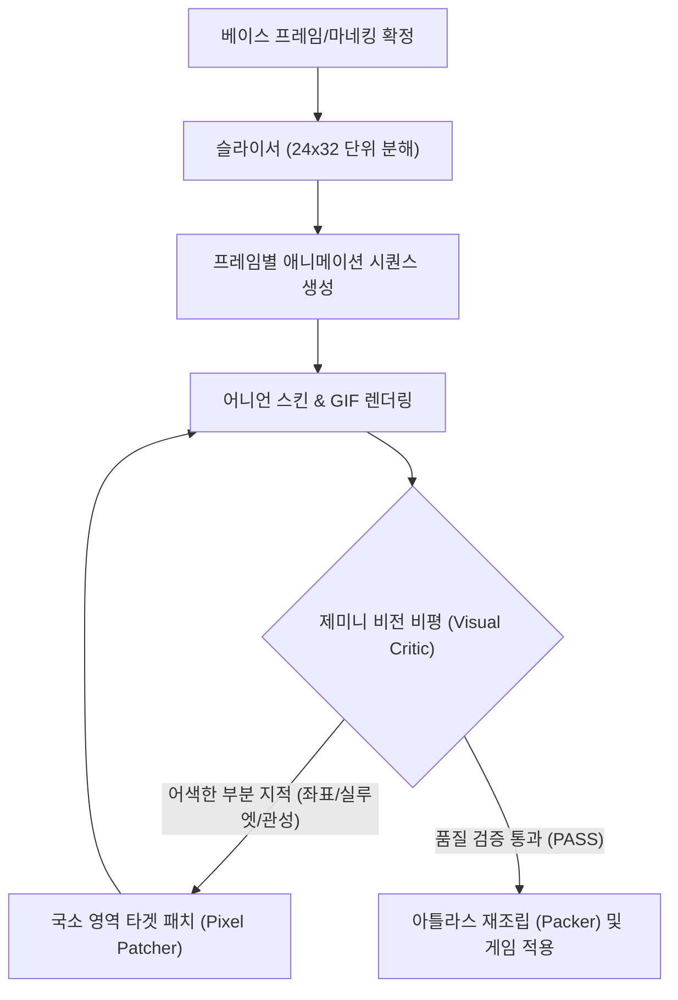

# 24x32 픽셀아트 캐릭터 애니메이션 엔지니어링 워크플로

본 문서는 **제미니(Gemini)의 풍부한 쿼터와 고성능 멀티모달 비전 추론**을 활용하여, 24×32 해상도 기반의 2D 픽셀아트 캐릭터 시트 제작, 애니메이션 검수, 부분 수정(In-painting/Patching), 리스킨(옷/헤어 변경) 퀄리티를 극한으로 끌어올리기 위한 엔지니어링 워크플로입니다.

---

## 1. 핵심 철학: "코드 보조 + 제미니 멀티모달 비평 루프 (Visual Critic Loop)"

일반적인 생성 AI는 도트 튀김(노이즈), 안티앨리어싱 번짐, 프레임 간 형태 붕괴가 빈번합니다.  
따라서 무작정 전체 이미지를 새로 생성하는 대신, **파이썬 기반의 결정론적 툴링(슬라이서, 팔레트 스왑, 어니언 스킨)**과 **제미니의 시각적 오류 검출 및 부분 수정 루프**를 결합합니다.



---

## 2. 작업 단계별 세부 워크플로

### 단계 1: 규격 및 베이스 마네킹(Mannequin) 정립
모든 캐릭터와 복장의 호환성을 유지하기 위한 헌법을 세웁니다.
- **캔버스 규격**: 가로 24px × 세로 32px
- **프로포션 가이드 (32px 기준)**:
  - 머리(0~11px): 외곽선 포함 높이 약 12px
  - 몸통/팔(12~19px): 약 8px
  - 다리/신발(20~31px): 약 12px
- **제한된 컬러 팔레트 (Indexed Palette)**:
  - 피부: 하이라이트, 미드톤, 섀도우 (3색)
  - 외곽선: 다크 네이비/블랙 계열 (1~2색)
  - 옷/헤어: 각 파트당 3단계 음영

---

### 단계 2: 파이썬 기반 자동화 툴체인 구축 (Tooling)
많은 반복(Iteration)을 사람이 일일이 수작업하지 않도록 작업 환경에 파이썬 스크립트를 배치합니다.

1. **Sprite Slicer / Packer**:
   - 아틀라스(`len_atlas.png`)를 개별 프레임 PNG(`idle_00.png`, `walk_01.png` 등)로 분해 및 재조립
2. **Onion Skin & Diff Generator**:
   - $N$번 프레임과 $N+1$번 프레임을 겹쳐 투명도 50%로 합성하거나, 픽셀 변화 차이(Diff)를 히트맵으로 시각화하여 제미니에게 제공
3. **Palette Swapper (옷 갈아입히기/리스킨)**:
   - 색상 인덱스 테이블만 교체하여 머리색, 옷색을 즉시 변경 (도트 형태는 100% 보존)
4. **Live Web Previewer**:
   - 로컬 브라우저에서 애니메이션 FPS(8fps, 12fps)를 조절하며 실시간 재생해 볼 수 있는 경량 HTML/JS 뷰어

---

### 단계 3: 애니메이션 이터레이션 루프 (The Critic-Patch Loop)

제미니의 저렴하고 풍부한 쿼터를 활용해 **합격할 때까지 무한 피드백 루프**를 돌립니다.

```
[1] 프레임 배치 -> [2] 제미니 시각적 검수 -> [3] 문제 픽셀 좌표 도출 -> [4] 국소 패치 -> [다시 검수]
```

#### A. 어색한 부분 찾기 (Visual Critique)
- 제미니 비전에 연속 프레임(또는 어니언 스킨 이미지)을 전달하고 다음 체크리스트를 검토하도록 지시:
  - **부피 보존 (Volume Consistency)**: 머리 크기나 다리 두께가 특정 프레임에서 줄어들거나 늘어나지 않았는가?
  - **접지점 (Foot Planting)**: 걷기/달리기 시 발이 땅에 닿는 기준선(Y좌표)이 흔들리지 않는가?
  - **도트 노이즈 (Stray Pixels)**: 외곽선 밖으로 튀어나온 1픽셀짜리 쓰레기 픽셀이 있는가?
  - **실루엣 가독성**: 배경과 겹쳤을 때 동작이 한눈에 읽히는가?

#### B. 국소 영역 수정 (Target Patching)
- 전체를 다시 그리지 않고, 문제가 된 **"머리카락 끝 4×4 영역"** 또는 **"오른발 6×6 영역"**만 좌표 기반으로 잘라내어 수정본을 덮어씌웁니다.

---

### 단계 4: 헤어 움직임 및 세컨더리 모션 (Secondary Motion)
24×32 해상도에서 머리카락 움직임은 **"덩어리 지연(Follow-through) 공식"**으로 단순화합니다:
1. **루트 프레임**: 캐릭터 머리가 위로 1px 올라가면, 머리카락 끝자락은 관성으로 1프레임 늦게 내려온 상태를 유지.
2. **2~3픽셀 블록 이동**: 머리카락의 꼬리 끝부분 2~3픽셀만 프레임별로 $(X \pm 1, Y \pm 1)$ 오프셋 적용.
3. **제미니 비전 검증**: GIF 생성 후 머리카락 궤적이 자연스러운 S자 곡선(물결)을 그리는지 분석.

---

## 3. 추천 실행 액션 플랜

1. **[인프라 세팅]** 기존 [len_atlas.png](file:///D:/V/pixelwork/src/len_atlas.png)을 24×32 규격으로 분해하고, 웹 브라우저에서 애니메이션을 바로 재생해 볼 수 있는 **HTML 뷰어 + 파이썬 슬라이서** 제작.
2. **[첫 번째 테스트: 리스킨]** 팔레트 스왑 스크립트를 작성하여 옷 색상/헤어 색상을 즉시 변경하는 파이프라인 검증.
3. **[두 번째 테스트: 애니메이션 수정]** 걸음걸이나 대기 모션 중 특정 1개 프레임의 머리카락 펄럭임을 추가하고 비평-수정 루프 테스트.
